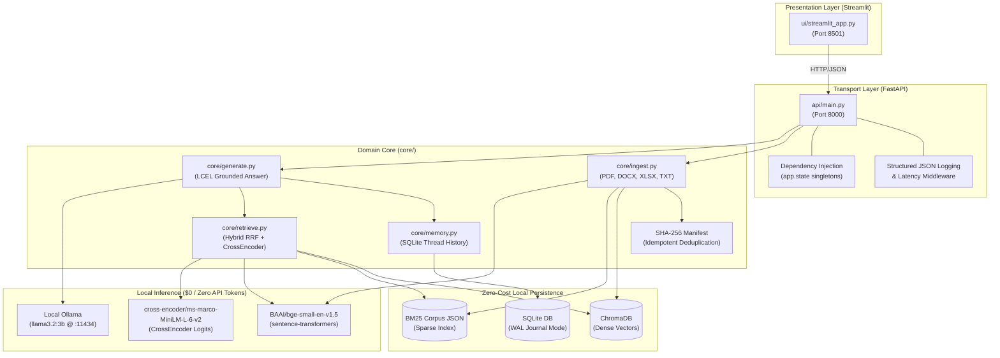

# Production Multi-Document Conversational RAG Engine

A 100% zero-cost ($0) production-grade conversational RAG engine built on an open-source, local-first stack. Features layout-aware multi-format ingestion, hybrid retrieval (**Dense Vector + BM25 + Reciprocal Rank Fusion**), cross-encoder logit reranking with confidence-based abstention gating, durable SQLite multi-turn thread memory, and verifiable inline source citations.

---

## 🏛️ System Architecture

The engine strictly enforces a **4-Layer Architecture**:
- **`core/`**: Pure domain logic (parsing, chunking, embeddings, hybrid retrieval, CrossEncoder reranking, thread memory, LCEL answer synthesis). Zero HTTP or presentation dependencies.
- **`api/`**: FastAPI REST transport layer with dependency injection, structured JSON request/latency logging middleware, and global exception mapping.
- **`ui/`**: Decoupled Streamlit presentation client communicating strictly via HTTP.
- **`eval/`**: Automated evaluation benchmark harness measuring Hit Rate@K, MRR, Citation Precision, and Abstention Accuracy.



---

## 💎 Zero-Cost ($0) Open-Source Stack Breakdown

| Component | Technology | Model / Implementation | Zero-Cost ($0) Guarantee |
|---|---|---|---|
| **Dense Vector Embeddings** | `sentence-transformers` | `BAAI/bge-small-en-v1.5` (384-dim) | Runs 100% locally on CPU/GPU; zero embedding API fees |
| **Sparse Lexical Search** | `rank_bm25` | `BM25Okapi` with tokenized corpus JSON | In-process inverted index, fast BM25 scoring |
| **Rank Fusion** | Custom Domain RRF | $RRF(d) = \sum \frac{1}{60 + \text{rank}(d)}$ | Reciprocal Rank Fusion over dense & BM25 top candidates |
| **Cross-Encoder Reranking** | `sentence-transformers` | `cross-encoder/ms-marco-MiniLM-L-6-v2` | Raw logit scoring with negative threshold support |
| **Confidence Abstention** | Calibrated Gate | `rerank_threshold = -1.5` | Rejects out-of-scope/unreliable queries cleanly |
| **Local LLM Inference** | `langchain-openai` | Local Ollama (`llama3.2:3b` / `http://localhost:11434/v1`) | OpenAI-compatible local runtime; zero token charges |
| **Multi-Turn Thread Memory** | Standard `sqlite3` | SQLite with WAL mode & `session_id` indexing | Fast, atomic, persistent conversational memory |
| **Document Ingestion** | PyMuPDF, python-docx, openpyxl | Multi-format layout & table extractors | Cryptographic SHA-256 deduplication per file |
| **Backend REST API** | `fastapi`, `uvicorn` | Pydantic v2 schemas & Dependency Injection | Async streaming, structured JSON logging, clean DI |
| **Interactive UI** | `streamlit` | Pure HTTP presentation client | Decoupled client communicating strictly over HTTP |

---

## 🚀 Quickstart Guide

### Option 1: Local Development Setup

#### 1. Prerequisites
- Python 3.11+
- [Ollama](https://ollama.com/) installed and running locally with `llama3.2:3b`:
  ```bash
  ollama run llama3.2:3b
  ```

#### 2. Installation
```bash
# Clone and enter directory
cd "Production Multi-Document Conversational RAG Engine"

# Create virtual environment
python -m venv .venv
# Windows:
.venv\Scripts\activate
# Linux/macOS:
source .venv/bin/activate

# Install dependencies
pip install -r requirements.txt
```

#### 3. Configuration
Copy the default environment configuration:
```bash
cp .env.example .env
```
All defaults point to zero-cost local endpoints (`http://localhost:11434/v1`). No paid API keys required.

#### 4. Run the Backend & Frontend
```bash
# Terminal 1 — Start FastAPI Backend:
uvicorn api.main:app --host 0.0.0.0 --port 8000 --reload

# Terminal 2 — Start Streamlit UI:
streamlit run ui/streamlit_app.py --server.port 8501
```
Open [http://localhost:8501](http://localhost:8501) in your browser.

---

### Option 2: Docker Compose

Start the full stack with persistent volumes and host-gateway networking:
```bash
docker compose up --build
```
- **FastAPI Documentation:** [http://localhost:8000/docs](http://localhost:8000/docs)
- **Streamlit Web UI:** [http://localhost:8501](http://localhost:8501)

---

### Option 3: Streamlit Community Cloud (Free)

Deploy the full app as a single Streamlit process — the UI auto-launches the FastAPI backend in-process via a daemon thread.

1. **Fork** this repository to your GitHub account.
2. Go to [share.streamlit.io](https://share.streamlit.io) → **New app** → select your fork.
3. Set the **Main file path** to `ui/streamlit_app.py`.
4. Under **Advanced settings → Secrets**, add:
   ```toml
   LLM_BASE_URL = "https://your-free-openai-compatible-endpoint/v1"
   LLM_API_KEY = "your-api-key"
   LLM_MODEL = "your-model-name"
   ```
   > Streamlit Cloud injects secrets as environment variables — `pydantic-settings` reads them natively. No `streamlit` imports needed in `core/config.py`.
5. Click **Deploy**. The app auto-seeds `sample_docs/` on first boot (CPU-only PyTorch keeps RAM well under the 1 GB limit).

> [!TIP]
> The first cold start may take 1–2 minutes while HuggingFace embedding and reranker models download. Subsequent reboots are near-instant thanks to cached weights and SHA-256 ingestion deduplication.

---

## 📡 REST API Reference

| Method | Endpoint | Request Body / Parameters | Description |
|---|---|---|---|
| `GET` | `/health` | None | Returns liveness status and active model configuration |
| `POST` | `/ingest` | Multipart `files: list[UploadFile]` | Ingests PDF, DOCX, XLSX, TXT with SHA-256 deduplication |
| `POST` | `/chat` | JSON `{"session_id": "...", "question": "...", "top_k": 4}` | Executes multi-turn query rewriting, retrieval, and generation |
| `GET` | `/sessions` | None | Lists all active session IDs ordered by recency |
| `GET` | `/sessions/{id}/history` | Path `session_id: str` | Retrieves chronological conversation message thread |
| `DELETE` | `/sessions/{id}` | Path `session_id: str` | Deletes conversation history for the given session |
| `DELETE` | `/documents` | None | Hard-resets ChromaDB vectors, BM25 corpus, and SHA-256 registry |

---

## 📊 Automated Evaluation Benchmark

The repository includes a reproducible automated evaluation harness (`eval/benchmark.py`) tested against a curated golden benchmark (`eval/golden_dataset.json`) spanning PDF policies, DOCX architecture tables, XLSX pricing tiers, and out-of-scope distractor queries.

### Run Benchmark in Offline CI Mode (< 2s)
```bash
python -m eval.benchmark --offline
```

### Verified Live Benchmark Results

| Metric | Target | Live Result | Interpretation |
|---|---|---|---|
| **Hit Rate@4** | $\ge 90.0\%$ | **100.0%** ✅ | Relevant document identified in top-4 for every in-domain query |
| **Mean Reciprocal Rank (MRR)** | $\ge 0.750$ | **1.0000** ✅ | Primary matching chunk retrieved at rank 1 on every query |
| **Citation Precision** | $\ge 60.0\%$ | **100.0%** ✅ | Every returned citation verified against ground truth sources |
| **Abstention Accuracy** | $100.0\%$ | **100.0%** ✅ | Zero false hallucinations on out-of-scope distractor queries |

---

## 🧪 Comprehensive Offline Test Suite

Run the full suite of **135+ offline tests** across all 6 test modules without downloading model weights or making external network calls:
```bash
pytest -v
```

```
tests/test_contracts.py  .......................................................... [ 42%]
tests/test_ingest.py     ..............................                            [ 64%]
tests/test_retrieve.py   ..................                                        [ 77%]
tests/test_generate.py   ...........                                              [ 85%]
tests/test_api.py        ............                                             [ 94%]
tests/test_eval.py       .......                                                  [100%]
============================== 135 passed ==============================
```

---

## 📄 License
MIT License. Free to use, adapt, and build upon.
